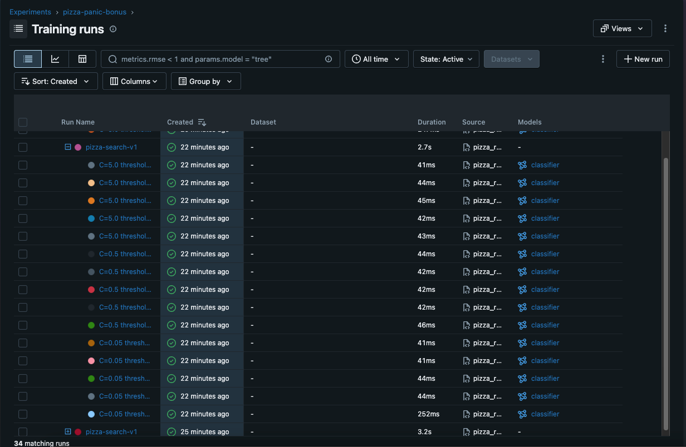

# Pizza Panic — My Completed Experiment

## 1. Identity and data versioning

| Field | My evidence |
| --- | --- |
| Student ID | S31409 |
| Dataset ID | Not specified — CSV files provided by the instructor via Microsoft Teams |
| Submitted repository or bundle | https://github.com/wh0isdeniz/highrev-exercise |
| Exact Git commit SHA | `e5d99416ace81fe560a90380c0f32349cce19a42` |
| DVC directory hash: `outs[0].md5` | `0a781b76b6f1620fda61c12f2bb9fa15.dir` |
| SHA256 of `orders.csv` | `7c99856c33d687eac2e364fc8a049ef70b9786e94ff43b6c2a2d92dc78910cbb` |
| SHA256 of `restaurants.csv` | `e04aa3336b0cc9800220853d8c17a320e72d6764722b401e5e93d6c8b7a1713f` |
| DVC push and clean Git/DVC evidence | [Data versioning evidence](evidence/01-data-versioning.txt) |
| Parent search run ID / final status | `2f8f125b0eba4f628253a37c7b761746` / Finished |

Git identifies the exact committed source, configuration and DVC pointer used for the experiment. DVC identifies the raw dataset version via `data/01_raw.dvc`, and the SHA256 digests additionally identify both CSV files. The raw files are stored in the DVC cache and a separately configured local DVC remote (`../highrev-exercise-dvc-remote`), not Git. MLflow stores searchable parameters, validation metrics, model artifacts, comparison artifacts, and provenance tags such as the Git SHA and DVC hash. The local remote is not automatically available to another computer; it must be provided or replaced with an accessible remote for third-party reproduction.

## 2. My Kedro integration

| Function | My node name | My input names, including parameters | My output names |
| --- | --- | --- | --- |
| `prepare_features` | `prepare_pizza_features` | `pizza_orders`, `pizza_restaurants` | `pizza_features` |
| `split_data` | `split_pizza_data` | `pizza_features`, `params:pizza_settings` | `pizza_split` |
| `search_candidates` | `search_pizza_candidates` | `pizza_split`, `params:pizza_settings`, `params:pizza_selection` | `pizza_results`, `pizza_models` |

- **Registry change:** In `src/highrev/pipeline_registry.py`, register the three-node graph under `pizza_panic`. The currently uncompleted older default pipeline is left empty in this standalone bonus project.
- **Catalog types and paths:** `pizza_orders`: `pandas.CSVDataset` at `data/01_raw/orders.csv`; `pizza_restaurants`: `pandas.CSVDataset` at `data/01_raw/restaurants.csv`; `pizza_results`: `pandas.CSVDataset` at `data/08_reporting/pizza_comparison.csv`, saved with `index: false`; `pizza_models`: `pickle.PickleDataset` at `data/06_models/pizza_models.pickle`.
- **Configuration environment and tag:** `conf/pizza` overlays `conf/base`; run with `env="pizza"`. MLflow records `kedro.env=pizza` and `kedro.pipeline=pizza_panic`.
- **Adapter execution call:** `return session.run(pipeline_name="pizza_panic")` in `src/highrev/pizza_run.py`.
- **Graph or execution-log attachment:** [Kedro execution log](evidence/04-kedro-execution.txt)
- **Memory versus persistent datasets:** `pizza_features` and `pizza_split` are implicit `MemoryDataset` intermediates, used within the run. The two input CSVs, comparison CSV, and pickle model outputs are file-backed datasets that survive the execution. DVC versions the raw CSV directory, not generated results.
- **Parameter wiring:** `conf/pizza/parameters_pizza.yml` supplies `pizza_settings` (`C` grid, thresholds, split settings and `max_iter`) and `pizza_selection` via `params:` inputs to Kedro nodes. The adapter can override the whole selection mapping at runtime for reproduction without modifying tracked source.
- **Environment overlay:** Kedro loads shared `conf/base` configuration and the selected `conf/pizza` overlay. The adapter explicitly creates `KedroSession` with `env="pizza"`; the CLI equivalent is `--env pizza`.

## 3. Candidate search

All candidate results below are from the **validation partition** and the first recorded search parent run. The comparison CSV retains higher precision than the rounded report values.

| C | Threshold | Child run ID | Status | Validation ROC AUC | Validation F1 |
| ---: | ---: | --- | --- | ---: | ---: |
| 0.05 | 0.20 | `4837eb160b724b9fba6710a12e09c46b` | Finished | 0.754891 | 0.512111 |
| 0.05 | 0.35 | `95b0953107a3433487081ee46106f347` | Finished | 0.754891 | 0.428571 |
| 0.05 | 0.50 | `b047ebd0c9724b7999576b4c22125b55` | Finished | 0.754891 | 0.108108 |
| 0.05 | 0.65 | `3eb3ae9cc027447db436ab647bb3b193` | Finished | 0.754891 | 0.058252 |
| 0.05 | 0.80 | `45f5fa2cfd7544339c31d76213f895b7` | Finished | 0.754891 | 0.000000 |
| 0.50 | 0.20 | `dd5cbffa924140d0973a4d3528f5c333` | Finished | 0.752952 | 0.514085 |
| 0.50 | 0.35 | `a27bee59aa37413db884b669128518ab` | Finished | 0.752952 | 0.427746 |
| 0.50 | 0.50 | `128d91c9914d4696b60d55b2aee7fbb8` | Finished | 0.752952 | 0.122807 |
| 0.50 | 0.65 | `8c48fb33cf6347cf9a16d77f55e20056` | Finished | 0.752952 | 0.093458 |
| 0.50 | 0.80 | `99cf25cd3a1047beb204533b81aa4250` | Finished | 0.752952 | 0.000000 |
| 5.00 | 0.20 | `69b82307e0424caeba840d589ec75c9e` | Finished | 0.752679 | 0.521429 |
| 5.00 | 0.35 | `d3ecdb1a0ad847589de386baa44ef8ce` | Finished | 0.752679 | 0.430233 |
| 5.00 | 0.50 | `f1fca9b00b684ae5942e1cdc64e8f331` | Finished | 0.752679 | 0.122807 |
| 5.00 | 0.65 | `e6e301efcb0144b6abcf68cbbec45644` | Finished | 0.752679 | 0.093458 |
| 5.00 | 0.80 | `d04f523f7aae4f52a1eaf44dd9979a90` | Finished | 0.752679 | 0.000000 |

**Scatterplot:**



**MLflow candidate runs:**


**My observation:** For a fixed `C`, ROC AUC stays unchanged across the five thresholds, because ROC AUC measures probability ranking and is not determined by a single binary classification threshold. F1 changes substantially as the threshold changes. For example, at `C=5.0`, lowering the threshold from 0.50 to 0.20 raises validation recall from approximately 0.0722 to 0.7526 and F1 from 0.1228 to 0.5214, but increases the predicted late warnings from 17 to 183. All three `C` settings have very similar ROC AUC values (about 0.7527–0.7549), while the decision threshold has a much larger effect on the practical warning policy.

**My interpretation:** The highest ROC AUC (`C=0.05`) does not automatically yield the best operational warning strategy: at threshold 0.20, `C=5.0` has a slightly lower ROC AUC but a higher validation F1 (0.5214 versus 0.5121). The experiments use a stratified 60/20/20 train/validation/test split, with the candidate comparisons computed on the validation data. The reserved test data must not influence hyperparameter or threshold selection; it is kept for an independent final assessment.

## 4. My recommendation

- **Selected settings:** `C=5.0`, `threshold=0.20`.
- **Original selected child run ID:** `69b82307e0424caeba840d589ec75c9e`.
- **Validation:** ROC AUC `0.7526793916505053`; F1 `0.5214285714285715`; precision `0.3989071038251366`; recall `0.7525773195876289`; predicted late warnings `183`.
- **Evidence-based choice:** This candidate has the highest observed validation F1 among the 15 combinations and catches about 75.3% of actual late orders on validation. In comparison, `C=0.05, threshold=0.35` achieves higher precision (about 50.7% compared with 39.9%) and only 71 predicted late warnings, but its recall drops to 37.1%. I favor the selected lower threshold when missing a genuinely late order is more costly than issuing some unnecessary warnings. Its precision means that roughly 60.1% of its warnings are false alarms, so this trade-off should be reviewed against the delivery company's actual costs.
- **Decision rule:** Obtain `predict_proba` for the `late` class from the fitted model and warn when `P(late) >= 0.20`; do not rely on the model's default `predict()` threshold.
- **Limitations:** This is a synthetic assigned dataset, and the recommendation is based only on validation metrics. No monetary false-positive/false-negative cost ratio was supplied, so an economic optimum cannot be claimed. The held-out test partition has not been used to select or evaluate the final policy.

## 5. Fresh-clone recovery

- **Recovery transcript:** [Fresh-clone reproduction evidence](evidence/05-reproduction.txt)
- **Exact selected reproduction command:**

```bash
KEDRO_DISABLE_TELEMETRY=1 uv run --locked python -m highrev.pizza_run \
  --name pizza-fresh-clone-reproduction \
  --reproduce \
  --c 5.0 \
  --threshold 0.20
```

- **Recovered parent run ID:** `eaa0a6f2cf604fd39431c750cb82f45f`.
- **Recovered child run ID:** `e386eb9f824e4d728388a1544f63c608`.
- **Final status:** Finished (three Kedro nodes completed successfully; one candidate produced).

| Check | Original candidate | Recovered candidate | Match? |
| --- | --- | --- | --- |
| Git commit | `e5d99416ace81fe560a90380c0f32349cce19a42` | Same commit from cloned repository | Yes |
| DVC hash | `0a781b76b6f1620fda61c12f2bb9fa15.dir` | Same | Yes |
| Both CSV SHA256 hashes | See Section 1 | Same digests verified after recovery | Yes |
| C and threshold | `5.0`, `0.20` | `5.0`, `0.20` | Yes |
| Split seed, split fractions, max_iter | `42`, test size `0.20`, validation fraction of remaining `0.25`, max_iter `800` | Same tracked YAML at identical Git commit | Yes |
| val_roc_auc | `0.7526793916505053` | `0.7526793916505053` | Absolute difference `0` |
| val_f1 | `0.5214285714285715` | `0.5214285714285715` | Absolute difference `0` |
| val_precision | `0.3989071038251366` | `0.3989071038251366` | Absolute difference `0` |
| val_recall | `0.7525773195876289` | `0.7525773195876289` | Absolute difference `0` |
| val_predicted_late | `183` | `183` | Yes |

All reproduced numeric metrics match exactly in the observed logs, within the assignment tolerance of `1e-8`.

**Why are run IDs different?** MLflow allocates a unique ID whenever a new run is created. The recovered experiment is a separate execution, using its own local MLflow database. Different IDs do not imply different code, data, settings, or metrics.

**Why did Git cloning alone not restore the CSVs?** Git stores the `.dvc` pointer and project code, while DVC stores the contents of the large/raw files in its cache and configured remote. A fresh clone therefore needs access to the DVC remote and must run `dvc pull` to restore the raw CSVs.

---

## Attachments checklist

- [x] DVC data hash and Git/DVC status evidence
- [x] MLflow candidate runs screenshot
- [x] ROC AUC vs F1 scatterplot
- [x] Kedro execution log
- [x] Fresh-clone reproduction log
- [x] Student ID and repository location
- [x] Dataset ID status explained
